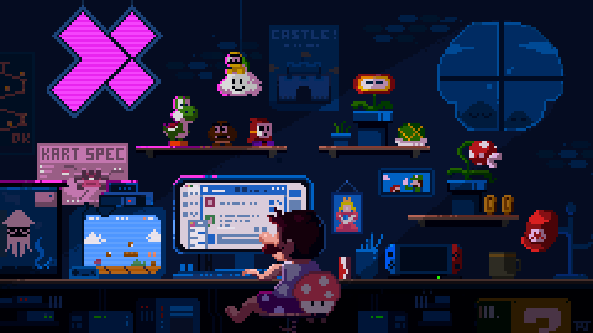

---
<h1 align="center">Rajan Jaiswal</h1>

<h3 align="center">
  Software Engineer · Full-Stack Development · Backend Systems · System Design
</h3>

  

  

---

## About

I'm a Computer Science undergraduate at **SRM University AP (Class of 2028)** focused on **software engineering, backend systems, full-stack development, and system design**.

I recently completed a **Product Engineering Internship at CCC Digital**, gaining hands-on experience building software around **Agentic AI and LLM-powered workflows**.

My primary focus is building reliable, maintainable software — from designing APIs and data models to developing full-stack applications, optimizing performance, and deploying production-oriented systems.

I enjoy solving engineering problems involving **data structures and algorithms, backend architecture, distributed systems, databases, APIs, concurrency, performance optimization, and developer tooling**.

Alongside core software engineering, I work with **LLMs, AI agents, RAG pipelines, and MCP** to explore how AI can be integrated into real-world software systems.

---

## Technical Skills

### Languages

  
  
  
  
  
  

### Core Concepts

  
  
  
  
  
  
  
  
  
  

### Frontend

  
  
  
  
  

### Backend & Databases

  
  
  
  
  
  
  

### Cloud, DevOps & Infrastructure

  
  
  
  
  
  
  
  
  
  

### AI / LLM Systems

  
  
  
  
  
  

---

## Highlights

- **Product Engineering Intern — CCC Digital**, with experience in Agentic AI and LLM-powered engineering workflows.
- **370+ DSA problems solved** across competitive programming platforms.
- Built and benchmarked a **C++ job scheduling engine** achieving up to **19.9× p50 latency improvement** over the original Python implementation at N=1M jobs.
- Built production-oriented **full-stack applications** using React, Next.js, Node.js, FastAPI and MongoDB.
- Developed systems involving **WebRTC, real-time communication, browser APIs, REST services, databases and cloud deployment**.
- Active contributor to **open-source software and developer tooling**.

---

## Analytics & Activity

  
  
  

  <picture>
    <source media="(prefers-color-scheme: dark)" srcset="https://raw.githubusercontent.com/platane/platane/output/github-contribution-grid-snake-dark.svg" />
    <source media="(prefers-color-scheme: light)" srcset="https://raw.githubusercontent.com/platane/platane/output/github-contribution-grid-snake.svg" />
    
  </picture>

 

  

---

## Contact

  
  

